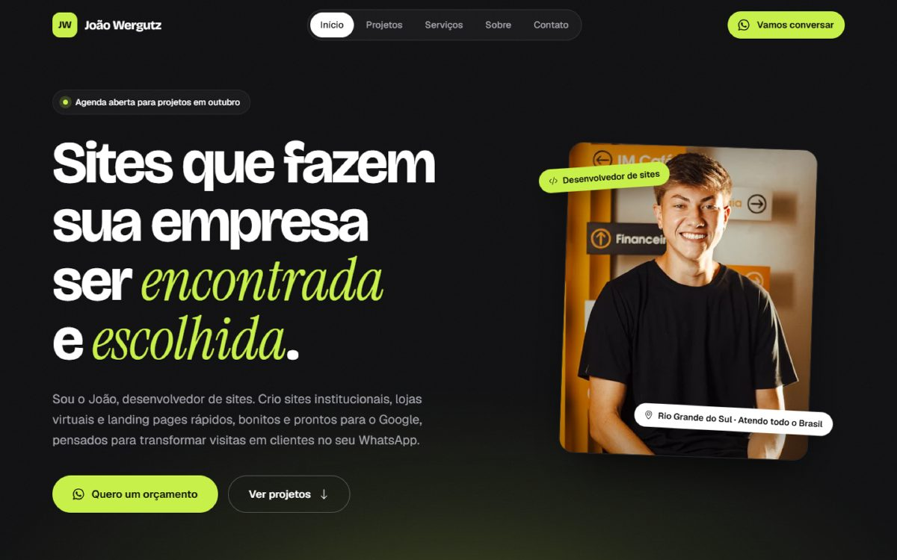

# João Wergutz — WordPress portfolio theme

Custom WordPress theme for my personal portfolio, written from scratch without page builders.

**Live site:** https://joaowergutz.github.io (static export of this theme)



## Highlights

- **Hand-coded classic theme:** PHP templates for each page, reusable components in `template-parts/components`.
- **Custom post type for projects:** case studies with their own single template (`single-projeto.php`).
- **Animations:** GSAP + ScrollTrigger and Lenis smooth scrolling, bundled locally (no CDN).
- **Performance:** self-hosted WOFF2 fonts, WebP images, and WordPress bloat removed (emojis, global styles, XML-RPC and other unused head output) in `inc/limpeza.php`.
- **Technical SEO:** titles, meta descriptions and structured data in `inc/seo.php`.
- **GA4 with cookie consent (LGPD):** Analytics only loads after the visitor accepts, and tracks WhatsApp clicks and lead form submissions (`inc/analytics.php`).
- **WhatsApp contact form:** builds the message in the browser and opens WhatsApp, with no server-side form handling.

## Structure

```
inc/              setup, post types, enqueues, SEO, analytics, cleanup
template-parts/   reusable components
assets/css        styles
assets/js         navigation, animations, contact form, analytics
assets/vendor     GSAP, ScrollTrigger, Lenis
```

## Requirements

WordPress 6.4+ and PHP 8.0+.

## Author

João Pedro Wergutz — [LinkedIn](https://www.linkedin.com/in/jo%C3%A3o-pedro-wergutz-27a6013b9/) · joaowergutz06@gmail.com
